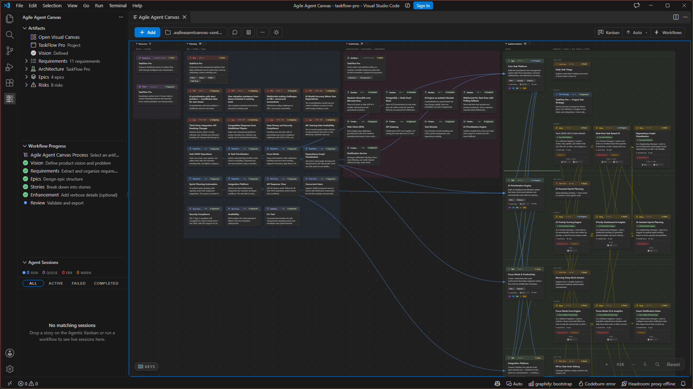
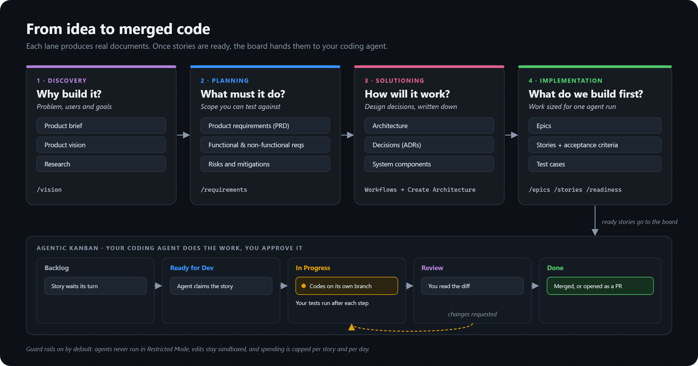
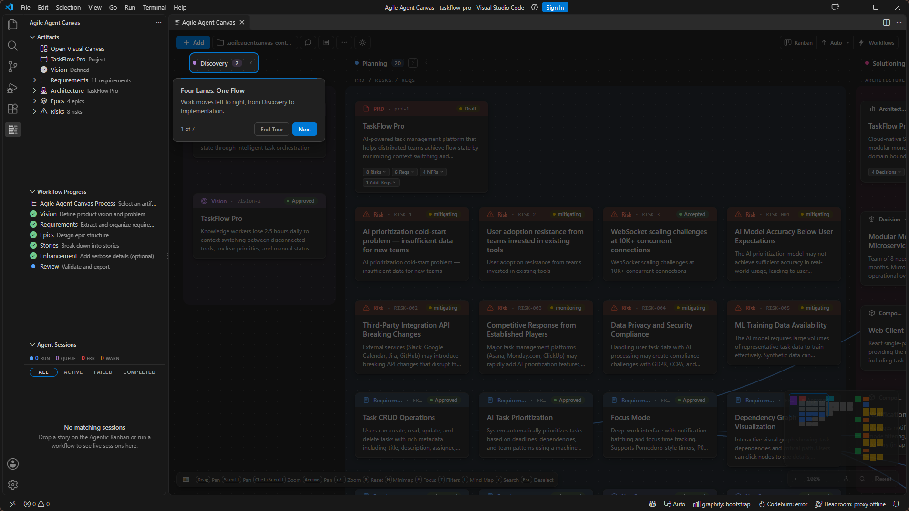
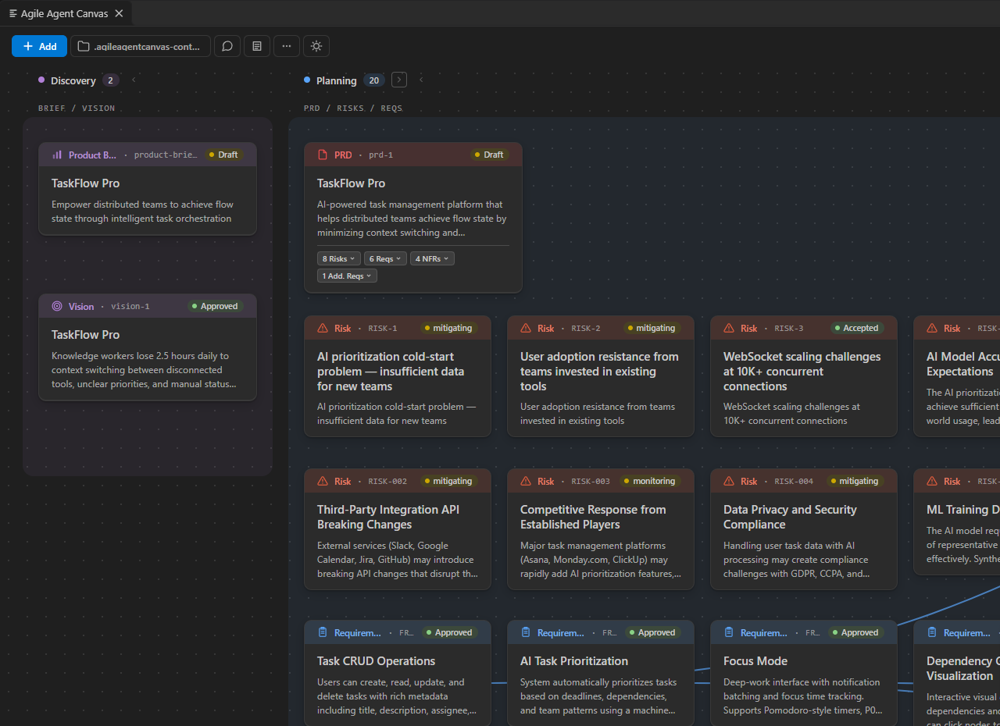
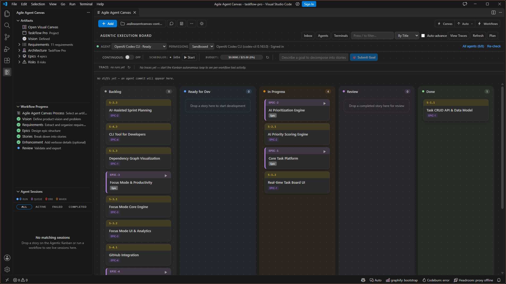
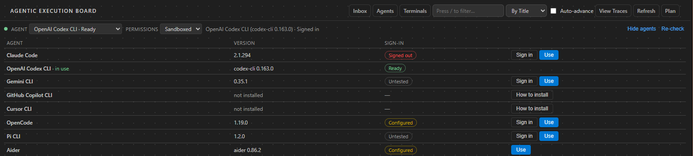
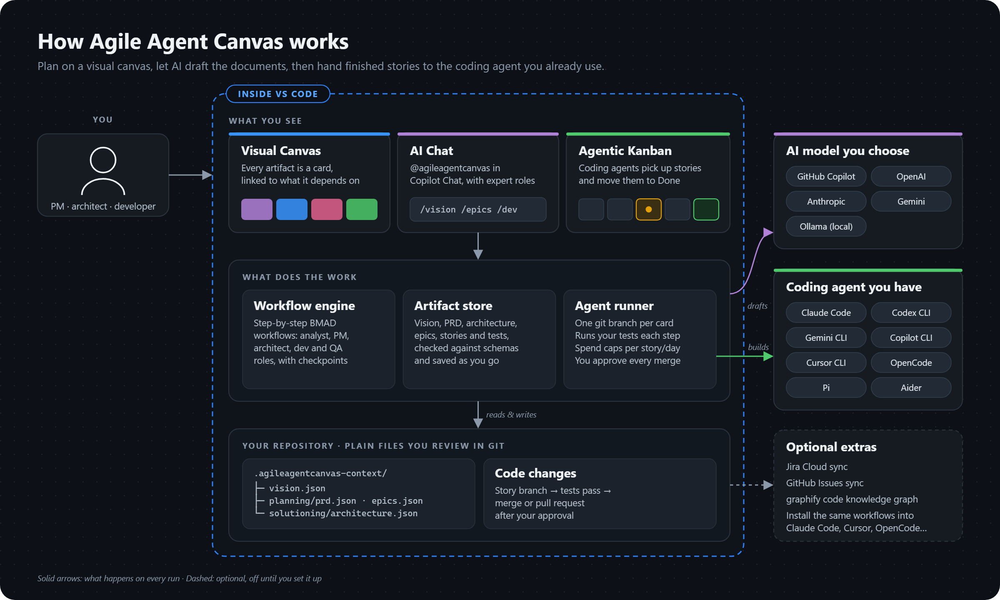

# Agile Agent Canvas

**Plan your product on a visual canvas, let AI write the documents, and let your coding agent build the stories, all inside VS Code.**



## What it does

1. **Plan visually.** Your vision, requirements, architecture, epics and stories appear as linked cards on one canvas, arranged left to right from idea to implementation.
2. **Draft with AI.** Ask `@agileagentcanvas` in Copilot Chat, or launch a guided workflow from the canvas. AI fills in the documents and the cards update as it goes.
3. **Build with agents.** Send ready stories to the Agentic Kanban board. The coding agent you already use (Claude Code, Codex, Gemini CLI, Copilot CLI and more) builds each one on its own git branch, runs your tests, and waits for your approval.

Everything is saved as plain JSON and Markdown in your repository, so your plan is versioned and reviewed like code.

## How it works



Each lane answers one question and produces real documents:

| Lane | Question | You get |
|---|---|---|
| **Discovery** | Why build it? | Product brief, vision, research |
| **Planning** | What must it do? | PRD, functional and non-functional requirements, risks |
| **Solutioning** | How will it work? | Architecture, design decisions, system components |
| **Implementation** | What do we build first? | Epics, stories with acceptance criteria, test cases |

The steps follow the open-source [BMAD Method](https://github.com/bmad-code-org/BMAD-METHOD), which ships with the extension. You don't need to know it to start: the AI guides each step.

## Get started in 2 minutes

1. **Install** Agile Agent Canvas from the Extensions view.
2. **Open a folder** and click the **Agile Agent Canvas** icon in the Activity Bar.
3. Click **Open Visual Canvas**, then **Create Sample Project** to explore a complete example. A short tour shows you around.
4. **Start your own project** from Copilot Chat:

   ```text
   @agileagentcanvas /vision I want to build a booking app for vet clinics
   ```

Not sure which command to use? Ask `@agileagentcanvas /help` and describe what you want to do.



## Features

### Visual Canvas

Every artifact is a card, color-coded by lane and connected to what it depends on. Switch between three views with `L`: **Lanes**, **Mind Map** and **3D graph**. Each card has a **Refine with AI** menu with the workflows that fit it, such as Dev Story, Code Review or Sprint Planning.



### AI chat in Copilot Chat

`@agileagentcanvas` brings expert roles (analyst, product manager, architect, developer, QA) into Copilot Chat. It can read and update your artifacts directly, so you never copy text between windows.

| Command | What it does |
|---|---|
| `/vision` | Define the product, the problem and who it's for |
| `/requirements` | Pull functional and non-functional requirements out of your notes |
| `/epics` | Group the work into epics that each deliver value |
| `/stories` | Break epics into stories with acceptance criteria |
| `/readiness` | Check everything is ready before development starts |
| `/dev` | Implement a story with full project context |
| `/workflows` | List every available workflow and command |

### Agentic Kanban

The board turns stories into work your coding agent picks up: **Backlog → Ready for Dev → In Progress → Review → Done**.



- **Your agent, your choice.** The board uses a coding agent you already have installed and shows whether it is signed in. You can switch agents with one click.
- **Safe by default.** Each card runs on its own git branch. Your tests run after every step, and failures go back to the agent. Nothing merges until you approve it, and you can open a pull request instead.
- **Spending limits.** Runs are capped at $5 per story and $25 per day by default. **Stop All Agents** stops everything at once.
- **Hands-off when you want it.** Turn on auto-advance to move cards through implement, review and done on their own. The board only pauses when it needs a decision from you.



| Coding agent | Command the board runs |
|---|---|
| Claude Code | `claude -p` |
| OpenAI Codex CLI | `codex exec` |
| Gemini CLI | `gemini -p` |
| GitHub Copilot CLI | `copilot -p` |
| Cursor CLI | `cursor-agent -p` |
| OpenCode | `opencode run` |
| Pi | `pi -p` |
| Aider | `aider --message-file` |

No coding CLI installed? The board falls back to the VS Code language model, such as GitHub Copilot.

### Visual Plan

Before any code is written, the AI can produce a plan for you to review: affected files, diagrams, API and data changes, open questions and a task list. Approve it and the selected tasks become stories on the board.

### Works with your tools

- **Jira Cloud.** Fetch epics and stories, and choose field by field when they conflict with your local copy.
- **GitHub Issues.** Sync issues with stories.
- **Code knowledge graph.** Optional [graphify](https://github.com/safishamsi/graphify) integration maps your codebase so the AI can answer questions like *"what depends on this module?"* from your real code.
- **Other AI tools.** **Install Framework to IDE** copies the same workflows and roles into Claude Code, Cursor, Antigravity, OpenCode or Copilot, so they behave the same everywhere.

## Architecture



- **What you see:** the canvas, the chat participant and the Kanban board, all inside VS Code.
- **What does the work:** a workflow engine that runs the guided steps, an artifact store that checks every document against a schema, and an agent runner that manages branches, tests, budgets and approvals.
- **Where it lives:** plain files in `.agileagentcanvas-context/` in your repository, plus normal git branches for code changes.
- **What it connects to:** the AI model you pick for drafting, and the coding agent you already use for building.

## Choose your AI model

Set `agileagentcanvas.aiProvider` in Settings. The default, `auto`, picks the best one available.

| Provider | Setup |
|---|---|
| **GitHub Copilot** | Works through the VS Code language model API. Nothing to configure. |
| **OpenAI**, **Anthropic**, **Gemini** | Run **Set AI API Key**. Keys are stored in your OS keychain, never in settings. |
| **Ollama** | Set `agileagentcanvas.baseUrl` to your local server, for example `http://localhost:11434`. |
| **Antigravity**, **Oh My Pi** | Route through those tools' own chat. |

`agileagentcanvas.chatProvider` chooses which chat tool the canvas buttons open (Copilot, Claude, Cursor, Windsurf, Codex, Aider, OpenCode and others).

## Requirements

- VS Code 1.93 or later.
- For AI features: GitHub Copilot, an API key for OpenAI, Anthropic or Gemini, or a local Ollama server.
- For the Kanban board: at least one coding agent CLI from the table above, or GitHub Copilot.
- Optional, for the code knowledge graph: Python 3.10 or later. The extension offers to install graphify for you.

## Reference

<details>
<summary><b>Common settings</b></summary>

| Setting | Default | Purpose |
|---|---|---|
| `agileagentcanvas.outputFolder` | `.agileagentcanvas-context` | Where artifacts are written |
| `agileagentcanvas.aiProvider` | `auto` | AI model provider |
| `agileagentcanvas.chatProvider` | `auto` | Chat tool the canvas actions open |
| `agileagentcanvas.agents.harness` | `auto` | Coding agent that runs board steps |
| `agileagentcanvas.agents.permissionPosture` | `sandboxed` | What agents may do without asking |
| `agileagentcanvas.budget.perStoryUsd` / `dailyUsd` | `5` / `25` | Spend caps (`0` turns a cap off) |
| `agileagentcanvas.kanban.autoAdvance` | `false` | Move cards through implement → review → done automatically |
| `agileagentcanvas.autoSync` | `true` | Save canvas changes to disk automatically |
| `agileagentcanvas.graphify.pythonPath` | `python` | Python to use if it isn't on PATH |

All settings are under **Settings → Extensions → Agile Agent Canvas**.

</details>

<details>
<summary><b>Most-used commands</b></summary>

Run these from the Command Palette (`Ctrl+Shift+P` / `Cmd+Shift+P`):

- **Open Visual Canvas**
- **New Project** / **Load Existing Project** / **Switch Project**
- **Check Agent Harnesses** / **Stop All Agents** / **Show Agent Run History**
- **Set AI API Key**
- **Generate Visual Plan** / **Open Visual Plan**
- **Install Framework to IDE**
- **Fetch from Jira** / **Set Jira API Token**
- **Bootstrap graphify** / **Update graphify Graph**

</details>

<details>
<summary><b>Canvas keyboard shortcuts</b></summary>

| Key | Action |
|---|---|
| Arrow keys | Pan |
| `+` / `-` | Zoom in / out |
| `0` | Reset zoom and pan |
| `F` | Focus mode |
| `M` | Minimap |
| `T` | Type and status filters |
| `L` | Switch view (Lanes → Mind Map → 3D) |
| `/` | Search |
| `Esc` | Close panel / deselect |

</details>

<details>
<summary><b>Agent permissions and limits</b></summary>

- `agileagentcanvas.agents.permissionPosture` defaults to `sandboxed`: agents can edit workspace files but get no unrestricted shell where the CLI supports it. `full` approves every tool automatically and needs a trusted workspace plus a one-time confirmation.
- Agents never run in Restricted Mode.
- If `agileagentcanvas.agents.harness` names an agent that isn't installed, runs are blocked with install instructions. The board never silently swaps in a different agent.
- `project-context.md` and `AGENTS.md` tell agents your build, lint and test commands and your conventions.
- **Show Agent Run History** lists what ran and how it ended.

</details>

## Open-source credits

Built on and inspired by open-source work, used under each project's license (MIT unless noted).

| Project | Used for | License |
|---|---|---|
| [BMAD-METHOD](https://github.com/bmad-code-org/BMAD-METHOD) | Bundled workflows, agent roles and schemas | MIT |
| [graphify](https://github.com/safishamsi/graphify) | Code knowledge graph (external tool, not bundled) | MIT |
| [ajv](https://github.com/ajv-validator/ajv) | Schema validation for artifacts | MIT |
| [yaml](https://github.com/eemeli/yaml) | YAML parsing | ISC |
| [@iarna/toml](https://github.com/iarna/iarna-toml) | TOML parsing | ISC |
| [gpt-tokenizer](https://github.com/niieani/gpt-tokenizer) | Token counting for context budgets | MIT |
| [headroom-ai](https://github.com/team-headroom/headroom) | Chat message compression | Apache-2.0 |
| [pdfkit](https://github.com/foliojs/pdfkit) | PDF export | MIT |
| [simple-git](https://github.com/steveukx/git-js) | Git operations | MIT |
| [deepmerge](https://github.com/TehShrike/deepmerge) / [microdiff](https://github.com/AsyncBanana/microdiff) | Merging and diffing artifacts | MIT |
| [React](https://react.dev) | Webview UI | MIT |
| [Three.js](https://threejs.org) / [3d-force-graph](https://github.com/vasturiano/3d-force-graph) | 3D graph view | MIT |
| [@xterm/xterm](https://xtermjs.org) | Live agent terminal output | MIT |
| [marked](https://marked.js.org) | Markdown rendering | MIT |
| [html2canvas](https://html2canvas.hertzen.com) | PNG export of the canvas | MIT |
| [@vscode/webview-ui-toolkit](https://github.com/microsoft/vscode-webview-ui-toolkit) | VS Code-style webview components | MIT |

Workflow and agent patterns were also informed by [get-shit-done](https://github.com/gsd-build/get-shit-done), [everything-claude-code](https://github.com/affaan-m/everything-claude-code) and [gstack](https://github.com/dzt/gstack) (all MIT). No source code is copied from them.

## Feedback

Found a bug or have an idea? [Open an issue](https://github.com/msayedshokry/AgileAgentCanvasExt/issues).
